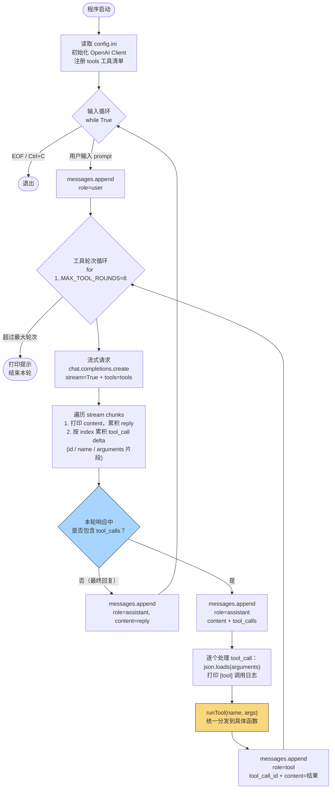
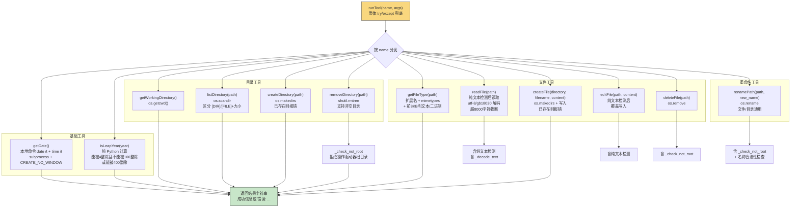
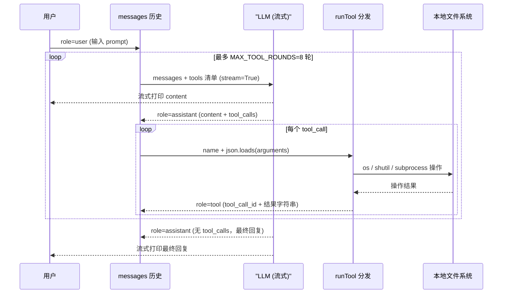

# chat-stream-tool-fileops.py 代码框架图

> 基于 `F:\LLM\agent\Practice02\chat-stream-tool-fileops.py`（514 行）绘制。
> 程序是一个流式多轮工具调用 Agent：LLM 通过 function calling 调用本地文件操作工具完成任务。

## 1. 主程序流程

## 2. 工具分发（runTool）

## 3. 数据流与消息历史

## 4. 工具清单

| 工具 | 必填参数 | 可选参数 | 实现方式 |
|---|---|---|---|
| getDate | - | - | 本地命令 `date /t`、`time /t`（subprocess） |
| isLeapYear | year | - | 纯 Python 计算 |
| getWorkingDirectory | - | - | `os.getcwd()` |
| listDirectory | path | - | `os.scandir` |
| getFileType | path | - | `os.path` + `mimetypes` + 二进制嗅探 |
| readFile | path | - | `open` + utf-8/gb18030 解码 |
| createFile | directory, filename | content | `os.makedirs` + `open(w)` |
| editFile | path, content | - | `open(w)` 覆盖写入 |
| createDirectory | path | - | `os.makedirs` |
| removeDirectory | path | - | `shutil.rmtree`（支持非空） |
| deleteFile | path | - | `os.remove` |
| renamePath | path, new_name | - | `os.rename`（文件/目录通用） |

## 5. 关键常量与安全约束

| 项 | 说明 |
|---|---|
| `MAX_TOOL_ROUNDS = 8` | 单轮对话最多 8 轮工具调用，防止死循环 |
| `MAX_READ_CHARS = 8000` | readFile 读取文本截断上限，防止撑爆上下文 |
| 纯文本检测 | readFile/editFile 通过文件前 8KB 是否含 `\x00` 判断二进制并拒绝 |
| 编码策略 | 优先 utf-8，回退 gb18030，均失败则报错 |
| `_check_not_root` | removeDirectory / deleteFile / renamePath 拒绝操作驱动器根目录 |
| renamePath 名称检查 | 新名称不得包含路径分隔符、不得与已有路径重名 |
